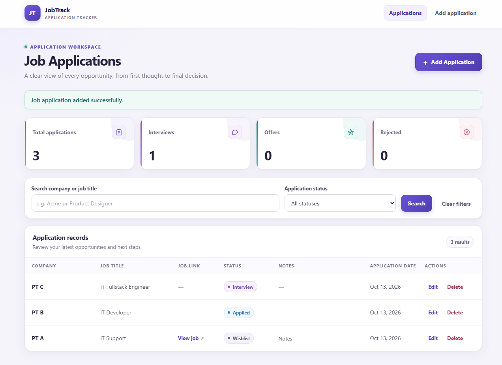
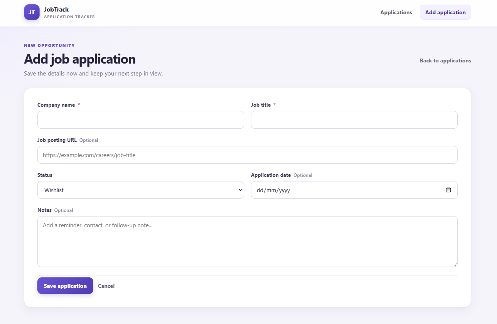

# JobTrack

JobTrack is a Laravel application for keeping job applications, their status, dates, and notes organized in one place. It is a single-user portfolio project built with server-rendered Blade pages.

## Features

- Create, list, edit, and delete job applications with company, job title, optional URL, status, application date, and notes.
- Search by company or job title and filter by status; combine filters and keep them while paging through results.
- View total application, interview, offer, and rejection counts.
- Receive server-side validation feedback and a confirmation prompt before deleting an application.

Statuses: Wishlist, Applied, Interview, Offer, Rejected, and Withdrawn.

## Technology

- PHP 8.3 (`^8.3`; the inspected local version is 8.3.13); Laravel Framework 13 (`^13.0`; installed locally as 13.35.0).
- Blade, plain CSS (`public/css/jobtrack.css`), and minimal JavaScript.
- SQLite is the checked-in default. Laravel also has MySQL and MariaDB connection configurations.
- PHPUnit 12 (the project requires `^12.5.12`; the inspected installation is 12.5.38).
- Vite, Tailwind CSS, and Node.js/npm are included for frontend asset development, but are not required to run JobTrack's pages.

## Screenshots

### Application Dashboard
View job application statistics, search and filter applications, and track each application's current status.



### Create Application
Add a job application with company details, job title, application status, date, and notes.



## Requirements

- PHP 8.3+ and Composer 2.2+.
- PHP extensions required by Laravel: `ctype`, `filter`, `hash`, `mbstring`, `openssl`, `session`, and `tokenizer`.
- PDO and one driver for the selected database: `pdo_sqlite` for SQLite or `pdo_mysql` for MySQL/MariaDB.
- To run the test suite, enable `pdo_sqlite`, `dom`, `json`, `libxml`, `mbstring`, and `xmlwriter` for the PHP CLI.
- A running MySQL or MariaDB server only if using that database instead of SQLite.

## Local setup (Windows PowerShell)

Clone the repository and install PHP dependencies:

```powershell
git clone https://github.com/arkadhyaksa-ep/jobtrack.git jobtrack
Set-Location jobtrack
composer install
Copy-Item .env.example .env
php artisan key:generate
```

The checked-in `.env.example` selects SQLite and leaves `DB_DATABASE` commented out. Laravel then uses `database/database.sqlite`. Create that file if it does not already exist, and run the migrations:

```powershell
if (-not (Test-Path database/database.sqlite)) {
    New-Item -ItemType File -Path database/database.sqlite | Out-Null
}
php artisan migrate
php artisan serve
```

Open the address printed by Artisan and visit `/applications`. Keep `.env` on your machine; it is ignored by Git. Generate an application key for a new environment, and do not replace a key that is already in use without a reason.

### MySQL or MariaDB

To use MySQL or MariaDB, first create an empty database and configure the local `.env` with `DB_CONNECTION=mysql`, `DB_HOST`, `DB_PORT`, `DB_DATABASE`, `DB_USERNAME`, and `DB_PASSWORD` for that server. Then run `php artisan migrate`. Use credentials appropriate to your local database; do not put them in this README or commit `.env`.

The local development `.env` in this workspace selects a MySQL-compatible connection. It is ignored by Git and is separate from the checked-in SQLite `.env.example`; no local credentials are part of the repository setup.

### Optional frontend tooling

JobTrack loads `public/css/jobtrack.css` directly, so Node.js/npm and Vite are not needed to run `/applications`. They are available for frontend asset development. From the project directory, install the JavaScript dependencies and build the Vite assets with:

```powershell
npm install
npm run build
```

## Tests

The PHPUnit configuration overrides the application database settings and uses an in-memory SQLite database (`DB_CONNECTION=sqlite`, `DB_DATABASE=:memory:`). Enable `pdo_sqlite` for the PHP CLI, then run:

```powershell
php artisan test
```

The most recent reported run passed 23 tests with 111 assertions.

## Project structure

- `app/Http/Controllers/` — request handling, validation, queries, and redirects.
- `app/Models/` — Eloquent models, including `JobApplication`.
- `database/migrations/` — Laravel and job application table definitions.
- `resources/views/job_applications/` — application list, create, and edit pages.
- `resources/views/layouts/` — shared JobTrack Blade layout.
- `resources/views/vendor/pagination/` — custom pagination view.
- `public/css/jobtrack.css` — shared JobTrack styles.
- `routes/web.php` — application routes.
- `tests/Feature/` and `tests/Unit/` — automated tests.

## Limitations

JobTrack has no authentication or per-user data isolation. Anyone with access to the application can view and change the same application records. It is a local, single-user portfolio prototype, not a production-ready or multi-user service.
